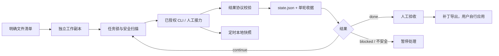

# Universal Handoff — macOS 本地多 Agent 接力系统

一个可部署的通用 Handoff Skill 加 Python 标准库调度器。支持 Codex、Google Antigravity、GitHub Copilot、Claude Code 和 Cursor 的官方非交互 CLI；缺少 CLI 或无法自动执行时提供人工 Prompt/结果导入。核实日期：2026-11-24。

**默认只运行本地 mock，不调用真实模型、不更改现有项目、不自动上传、提交或推送。** 真实任务需要显式文件清单和逐服务授权。副本隔离不等于操作系统沙箱；先阅读 [安全边界](docs/SAFETY.md)。

## 从这里开始

- [安装与本地演示](docs/INSTALL.md)：Python 3.9+、零第三方运行依赖、可选个人 Skill、可选 launchd。
- [工具适配与官方依据](docs/ADAPTERS.md)：实际命令、权限差异、Skill 目录、人工回退和验证范围。
- [操作手册](docs/OPERATIONS.md)：任务创建、授权、自动保存、调度、人工交接、恢复与导出。
- [统一状态协议](docs/PROTOCOL.md)：状态机、结果校验、预算和持久化语义。
- [测试与验证记录](docs/TESTING.md)：自动测试、安装演示、未执行的真实服务联调。
- [通用 Skill](skill/universal-handoff/SKILL.md) 和 [机器可读协议](schemas/result.schema.json)。

## 快速验证

在本目录执行：

```sh
PYTHONDONTWRITEBYTECODE=1 python3 -m unittest discover -s tests -v
python3 handoff.py --help
```

安装：

```sh
./install.sh \
  --prefix "$HOME/.local/share/agent-handoff-v1" \
  --state-home "$HOME/Library/Application Support/AgentHandoff"
```

这只创建新安装和本地状态，不加载后台服务。详细命令见 INSTALL.md。

## 架构与已实现内容



每任务串行接力，不同任务各有独立副本；不是同目录并行编辑系统。自动调度每 tick 最多一轮，轮次和快照容量有限制。代码检查点采用内容哈希快照，没有自动 Git commit、worktree 创建或原项目回滚。

支持原子状态写入、独占锁、心跳、进程组超时清理、二进制固定、授权撤销、防过期结果/重放、敏感内容基础拦截、可选有界故障切换、快照恢复和文本补丁导出。`done` 进入 review，由用户验收；异常中断的 running 任务需人工确认孤儿进程停止后恢复。

不会自动控制 GUI、登录、修改服务权限、读取统一剩余额度、切账号或保证额度耗尽后可以继续。有效摘要只在轮次结束保存，快照不包含未保存编辑器内容或模型实时上下文。真实 CLI 的权限和用户配置必须单独审查。

## 文件布局

```text
agent-handoff/
├── handoff.py                  命令入口
├── handoff/                    存储、调度、适配、CLI
├── install.sh / install.py      不覆盖现有目录的本地安装器
├── config.example.json         配置示例
├── skill/universal-handoff/     可独立安装的通用 Skill
├── schemas/                    状态和结果 JSON Schema
├── examples/                   无网络演示输入
├── tests/                      真实本地进程/文件系统测试 + 适配 fixtures
└── docs/                       中文安装、协议、适配、安全和运维文档
```

本机只验证了 Codex CLI 的版本及所用参数；其他四种 CLI 未安装，已实现官方文档对应的适配和本地 feature gate。所有自动测试使用 mock、静态厂商输出样本或本地 Python 子进程，未进行真实模型请求。部署前以 doctor 与你的已授权小任务完成服务联调。
