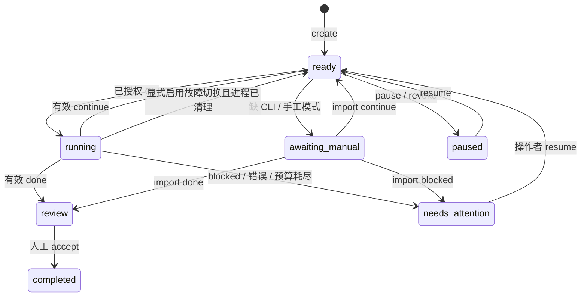

# 统一交接协议 v1

协议分成三层，避免把 Agent 的文字输出当成调度命令。

| 文件/对象 | 写入者 | 用途 |
|---|---|---|
| `state.json` | 本地控制器 | 权威状态、修订号、授权、轮次预算、进程组和检查点 |
| `runs/RUN_ID.json` | 本地控制器 | 单轮有效结果或固定错误码的收据 |
| Result JSON | Agent 返回，控制器校验 | 可携带的目标进展、决策、下一步、阻塞和测试记录 |
| `snapshots/SHA256/` | 本地控制器 | 内容哈希快照、文件清单和执行位 |
| `HANDOFF.md` | 本地控制器派生 | 供人阅读；崩溃时以 `state.json` 为准 |
| `MANUAL_PROMPT.txt` | 本地控制器派生 | 本轮人工接力指令；仅在 `awaiting_manual` 时有效 |

机器定义位于 `schemas/state.schema.json` 和 `schemas/result.schema.json`。运行时只需 Python 标准库，直接检查协议版本、字段、类型、长度、敏感信息和本轮标识，不依赖 JSON Schema 库。

`protocol_version=1`；不支持的版本立即停止。`task_id` 在控制器中唯一；每轮随机 `run_id`，并固定 `base_revision`。心跳会增加全局 `revision`，但不会改变本轮 `base_revision`。结果只可提交给当前运行，已消费的结果不可重放。每轮最多使用一次结果；`outcome` 只能是 `continue`、`done`、`blocked`。所有字段名和限制见 Skill 的协议参考。

`done → review` 是刻意的验收边界。控制器不把自然语言测试记录当作已验证测试，也不执行 Agent 提供的测试字符串；本包不会运行原项目的测试或安装其依赖。默认 Claude/Copilot 的命令执行权限有限，无法测试时应返回 `blocked` 或明确说明未测。对代码变更的验收由用户在可信环境中进行。

每轮启动前、每次保存间隔、结束后都会尝试保存代码快照；未变化的内容复用同一哈希。扫描包括内容及执行位，拒绝符号链接、硬链接、特殊文件、隐藏/凭据/自动配置路径和部分常见密钥格式。若扫描与复制期间检测到变化或敏感内容，停止本轮并保留上一有效快照。文件名和内容哈希组成快照标识；空目录、所有权、扩展属性和其他权限位不纳入协议。

单文件最多 1 MiB；工作副本最多 2000 文件、20 MiB；每任务最多 64 个不同快照，包括未清理的快照临时目录。预算耗尽后停止，无静默删除。每任务最多 1–100 轮（默认 6），轮次在启动前持久化，崩溃也计入预算。预算不能被自动恢复或续作清零；需要更长任务时，人工复核后从已审查副本创建新任务。

磁盘写入使用同目录临时文件、文件 `fsync`、原子替换和父目录 `fsync`。快照完成后重读工作树确认哈希。状态更新与人类视图不是跨文件事务；进程可能在启动与记录 PGID 之间崩溃，因此不能仅凭 PGID 缺失自动重跑。中断轮次保留现场，人工确认后恢复，默认不会重复执行。
